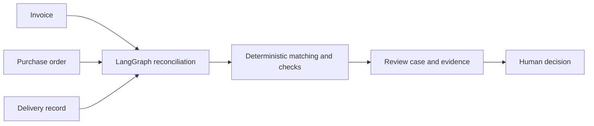

# Mismatch Desk

**An AI-assisted invoice discrepancy desk for small distributors.** Compare a supplier invoice with its purchase order and delivery records, explain exceptions with evidence, and let a human reviewer decide what happens next.

This project focuses on the messy handoff between purchasing, warehouse receiving, and finance. It is not a generic document chatbot and it never approves or pays an invoice by itself.

## Why it exists

An invoice can be readable and still be wrong for the business: a partial delivery may be billed as complete, the supplier's item label may differ from the purchase order, or a duplicate may arrive through another channel. Mismatch Desk turns those cases into a review queue with linked evidence, explicit rules, and an audit trail.

## First milestone

- A typed Python API accepts an invoice, purchase order, and delivery record.
- A LangGraph workflow compares line items and runs deterministic quantity and price checks.
- The API returns structured discrepancies suitable for a reviewer UI.
- Synthetic cases exercise partial delivery and price mismatch scenarios.

The current build includes a small Next.js review interface and an OpenRouter-backed endpoint that extracts typed invoice fields from text. It attaches exact source quotes and flags missing, ambiguous, or unsupported fields for human review. Later milestones can add PDF extraction, AI-suggested line matching, a resumable human-review interrupt, evaluation, tracing, and PostgreSQL persistence. The model must never make the final business decision.

## Architecture



## Run locally

```bash
cd backend
python -m venv .venv
source .venv/bin/activate
pip install -e '.[dev]'
uvicorn mismatch_desk.main:app --reload
```

Open `http://127.0.0.1:8000/docs`. Reconciliation accepts structured JSON; PDF extraction will be added as a separate milestone so its accuracy can be evaluated independently from reconciliation.

To enable model-backed extraction, copy `.env.example` to `.env` in the project root and set `OPENROUTER_API_KEY` to your key. Never commit `.env` or put the key in frontend code. `OPENROUTER_MODEL` defaults to `openai/gpt-4o-mini`; change it to a model in your OpenRouter account that supports structured outputs. The sample document contains synthetic data. Model requests use OpenRouter credits.

Try `POST /api/invoices/extract` in the API docs using the contents of `examples/invoice_text.txt` as `document_text`. The response includes extracted values, exact source quotes, and whether a human should review the result. OpenRouter's structured output mode constrains model responses to a JSON schema, and the app then checks that each quote appears in the submitted text. [OpenRouter structured outputs](https://openrouter.ai/docs/guides/features/structured-outputs)

In a second terminal, run the UI with `cd frontend && npm install && npm run dev`, then open `http://localhost:3000`. It calls the API at `http://localhost:8000` by default; set `NEXT_PUBLIC_API_BASE_URL` if you run the API elsewhere.

Try `POST /api/reconciliation` with [`examples/partial_delivery.json`](examples/partial_delivery.json). It should flag that the invoice bills 100 units while the delivery record contains 80, and that the invoice unit price differs from the order.

`POST /api/invoices/reconcile-from-text` accepts `document_text`, a structured `purchase_order`, and `deliveries`. It extracts invoice fields with OpenRouter, returns source quotes and review reasons, and only runs reconciliation when the extraction can be represented by the supported invoice model. If evidence is missing, ambiguous, or invalid for that model, the response has `reconciliation: null` so a person can review the extraction first.

## Engineering principles

- Use exact identifiers for automatic matching; ambiguous matches should become review items.
- Keep monetary and quantity arithmetic in deterministic code using decimal values.
- Return discrepancy codes and evidence, not only free-form explanations.
- Build a labeled synthetic evaluation set with hard cases and publish the measured results and limitations.
- Keep uploads and sample documents synthetic and free of personal or confidential data.

## Status

Early development. The API now has a real OpenRouter-backed text extraction endpoint; the dashboard still uses the structured sample case for reconciliation.
